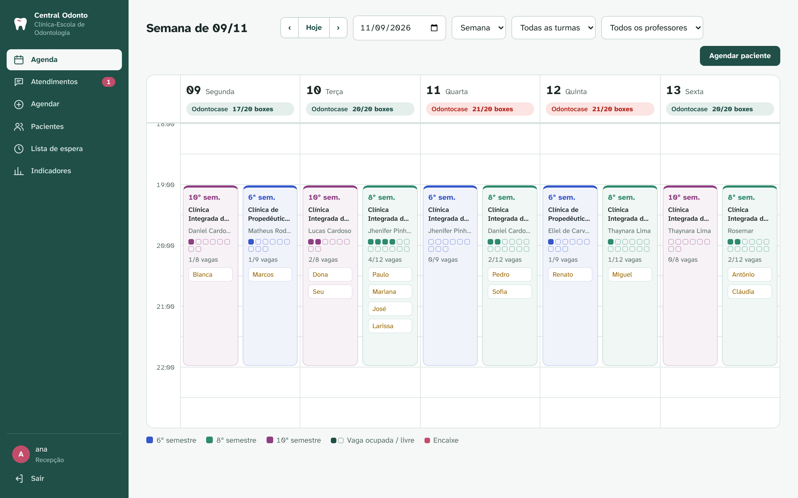
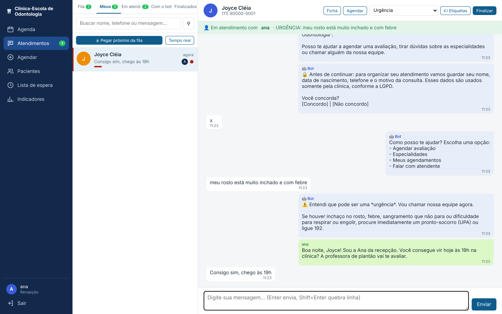
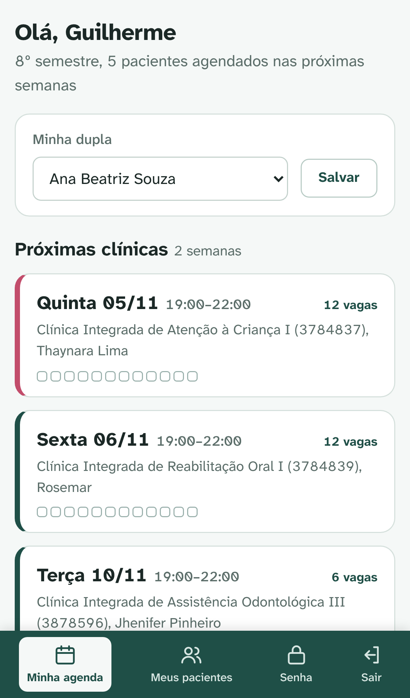
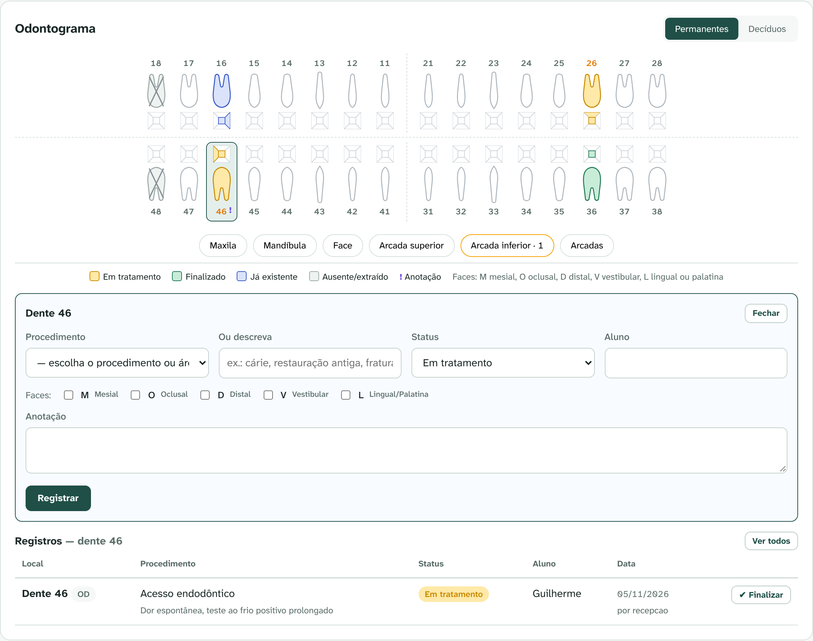

# 🦷 Central Inteligente de Atendimento Odontológico

Sistema da **clínica-escola de Odontologia**: agenda por **turma, dia de clínica, professor e
procedimento**, **central de atendimentos do WhatsApp** (bot + fila humana), cadastro de pacientes com
**odontograma** e **prontuário físico digitalizado**, e lembretes automáticos para não perder pacientes.



> Este README foi escrito para quem **não programa**. A parte técnica para o
> programador está em [`docs/ARQUITETURA.md`](docs/ARQUITETURA.md).

---

## Como o sistema pensa a clínica

```
TURMA (6º, 8º, 10º semestre)
  └─ CLÍNICA = um horário fixo da semana
       ex.: 8º semestre · Terça 19:00–22:00 · Jhenifer Pinheiro
            Clínica Integrada de Assistência Odontológica III (3878596)
            Áreas: Triagem/Anamnese + Endodontia
            Procedimentos: anamnese, capeamento pulpar e acesso
            10 pacientes por dia · qualquer idade
       └─ o sistema gera TODAS AS DATAS do semestre (pula feriados)
            └─ AGENDAMENTOS (pela recepção ou pelo WhatsApp)
                 → lembrete automático → Veio / Faltou
PACIENTE → ficha + nº do prontuário físico + fotos/PDF das folhas do prontuário
```

**Vagas = alunos ÷ 2 (duplas) × pacientes por dupla.** Cada dupla ocupa um box. Quando duas turmas atendem
na mesma clínica física no mesmo horário, as duplas somam e a agenda mostra, no topo de cada dia,
"Odontocase 21/20 boxes" em vermelho quando falta box.

Cada clínica pode ter **faixa etária**: Adolescente (10 a 19 anos), Criança (até 12) e Idoso (60+). O sistema e o bot só oferecem a clínica certa para a idade do paciente.

---

## Telas (abra no navegador: `http://endereço-do-servidor:8000`)

| Tela | Para quem | O que faz |
|---|---|---|
| **Atendimentos** | Recepção | Caixa de entrada do WhatsApp: abas **Fila / Meus / Em atendimento / Com o bot / Finalizados**, **pegar próximo da fila**, setores, etiquetas, filtros, busca por mensagem e painel **Tempo real** (TME/TMA) |
| **Agenda** | Recepção | Grade de horários (semana ou dia) com as clínicas das turmas lado a lado, horário de cada paciente, filtro por professor e turma. Clique num dia para ver a lista, marcar **Veio/Faltou**, anotar o **aluno**, fazer **encaixe** ou **bloquear o dia** (professor ausente, prova...) |
| **Agendar** | Recepção | Escolha o paciente e o procedimento: o sistema mostra **só as clínicas que fazem esse procedimento**, com vaga e na idade certa |
| **Pacientes** | Recepção | Busca por nome, telefone, CPF ou **nº do prontuário físico**. A ficha tem os dados, as consultas, o **odontograma** e o **prontuário digitalizado** |
| **Lista de espera** | Recepção | Quem não encontrou vaga, com botão para agendar quando abrir |
| **Indicadores** | Coordenação | Novos pacientes, % que agendou, faltas, ocupação de cada clínica, pacientes de dias bloqueados para remarcar, conversas abandonadas no WhatsApp |
| **Clínicas** | Coordenação | Cadastrar e editar os dias de clínica de cada turma. Ao salvar, a agenda do semestre é refeita |
| **Área do aluno** (celular) | Aluno | Vê as clínicas da **própria turma**, forma a **dupla**, agenda pacientes, altera horário e procedimento, remarca, marca presença e abre ficha, odontograma e prontuário **só dos pacientes da dupla** |
| **Área do professor** (celular) | Professor | Vê os dias das clínicas que **supervisiona** (todas as turmas), com pacientes, duplas, procedimentos e alertas de saúde; marca **veio/faltou** e abre ficha e odontograma desses pacientes |
| **Usuários** | Coordenação | Criar login para cada pessoa (recepção, coordenação, professor ou aluno), **cadastrar a turma inteira colando a lista de nomes** (gera cartões de login para imprimir), gerar senha provisória, redefinir senha esquecida e desativar quem saiu |
| **Acessos** | Coordenação | Quem entrou, abriu fichas, viu documentos ou mudou dados (LGPD) |

### Atendimentos (WhatsApp) 💬
Quando o bot detecta urgência ou o paciente pede um atendente, a conversa entra na **fila** do setor
(Urgência vai primeiro). A recepção clica em **Pegar próximo da fila**, conversa, coloca **etiquetas**,
**transfere** de setor e **finaliza**; aí o bot volta a atender aquele paciente. A tela se atualiza
sozinha a cada 5 segundos. Também dá para **assumir uma conversa que está com o bot** ou iniciar uma
pela ficha do paciente.

> Regra do WhatsApp: 24h depois da última mensagem do paciente só é possível enviar um **modelo aprovado**
> (`TEMPLATE_CONTATO`). O sistema avisa e mostra o botão.



### Área do aluno 📱
O aluno entra pelo celular com o próprio login e cai direto em **Minha agenda**: as próximas clínicas da turma,
as vagas livres e os pacientes da dupla. Ele agenda (respeitando vagas e faixa etária), muda horário e
procedimento, **remarca** para outro dia da turma, marca **veio/faltou** e cancela. Encaixe acima do limite
continua sendo só da recepção. O aluno não vê a lista geral de pacientes, o WhatsApp nem os indicadores.



### Odontograma 🦷
Na ficha do paciente: dentes **permanentes e decíduos** (numeração FDI), clique no dente, escolha o
procedimento, as **faces** (M O D V L), o status (**em tratamento**, **finalizado**, **já existente**,
**ausente**), o aluno e uma anotação. Também registra por região (maxila, arcadas...).



### Prontuário digitalizado 📁
Na ficha do paciente, clique em **"Escolher arquivos"**. **No celular, isso abre a câmera:** fotografe
cada folha do prontuário físico, escolha o tipo (anamnese, odontograma, radiografia, termo...) e anexe.
Aceita JPG, PNG e PDF.

> ⚠️ **Valor legal:** a lei (Lei 13.787/2018) só permite **descartar o papel** se a digitalização
> seguir regras próprias, com certificado digital ICP-Brasil. Por enquanto trate as fotos como **cópia de
> consulta** e **guarde o prontuário físico**. Confirme com a coordenação e o jurídico da faculdade.

### WhatsApp 💬
| Função | Como funciona |
|---|---|
| Resposta imediata + aviso LGPD | Boas-vindas e menu; o paciente concorda antes de informar dados |
| Pré-triagem | Nome → nascimento → motivo → turno preferido. O paciente vai para a fila **Triagem (ASB)** e a ASB agenda com os alunos (modo padrão `MODO_AGENDAMENTO_BOT=triagem`) |
| Agendamento direto (opcional) | Com `MODO_AGENDAMENTO_BOT=direto`, o próprio paciente escolhe área e horário (só clínicas da idade dele) |
| Valores e endereço | Tabela de taxa social, endereço e horários (edite em `bot/app/textos.py`) |
| Urgência | "rosto inchado", "dor muito forte", "não para de sangrar"... chamam um humano |
| Atendimento humano | A conversa vai para a **fila** da tela Atendimentos |
| Lembrete | 24h antes, com botões **Confirmo** / **Remarcar** |
| Recuperação | Quem parou no meio do agendamento recebe um "quer continuar?" |
| Agendado pela recepção | O paciente pode ser avisado pelo WhatsApp (caixa "Avisar o paciente") |

---

## O que dá para mudar sem programar ✏️

| Quero mudar... | Onde |
|---|---|
| **Dias de clínica, professores, áreas, alunos, idades** | Tela **Clínicas** (coordenação) |
| **Boxes de cada clínica física** | Tela **Clínicas**, em "Clínicas físicas e boxes" |
| **Feriados e recessos** | `bot/dados/feriados.csv`, depois **Clínicas → Atualizar agenda do semestre** |
| **Lista de procedimentos** | `bot/dados/procedimentos.csv` (área;procedimento) |
| **Áreas (especialidades)** | `bot/dados/especialidades.csv` (`mostrar_no_bot` = sim/nao) |
| **Mensagens do bot e palavras de urgência** | `bot/app/textos.py`, depois `docker compose restart bot` |
| **Datas do semestre, usuários e senhas** | arquivo `.env` |

Os logins iniciais (professores e coordenação) vêm de `bot/dados/usuarios_iniciais.csv` e são criados com senha
provisória. A coordenação imprime os cartões em **Usuários → Cartões de primeiro acesso**.

A grade inicial das turmas vem de `bot/dados/sessoes_clinica.csv` e só é importada **na primeira vez**.
Depois disso, use a tela **Clínicas**.

> ✅ A grade vem da **Grade 2026.2 Odonto Noturno** (6º, 8º e 10º semestre, só as disciplinas em
> CLÍNICA/ODONTOCASE; pré-clínica, teoria e estágios em campo externo não recebem pacientes).
> ✅ Levantamento: noturno das **18:00 às 21:30**, 6º com 23 alunos, 8º com 13, 10º com 12, **1 paciente por dupla**
> (encaixe pela recepção). ⚠️ Falta: **nº de boxes** do Odontocase e a **grade do diurno** (08:30 às 12:00).

> 💡 Ao salvar um CSV no Excel, escolha **"CSV UTF-8"** para os acentos não quebrarem.

---

## Programas usados (todos de código aberto)

| Programa | Para quê | Licença |
|---|---|---|
| Python + FastAPI | sistema da clínica e bot | MIT/BSD ✅ |
| PostgreSQL | banco de dados | PostgreSQL (livre) ✅ |
| Chatwoot (edição *Community*) — **opcional** | outra caixa de atendimento, se preferirem | MIT ✅ |
| Redis | fila interna do Chatwoot | BSD/RSAL (uso interno ok) ✅ |
| Cloudflared | endereço público temporário para testes | Apache 2.0 ✅ |

---

## Passo a passo para colocar no ar

### Passo 0: o que você precisa
- Um computador ou servidor com **Docker** instalado ([docker.com](https://www.docker.com/products/docker-desktop/)).
- Uma conta no **Meta for Developers** ([developers.facebook.com](https://developers.facebook.com)).

### Passo 1: testar sem WhatsApp (simulador)
Você conversa com o bot direto no terminal:
```bash
cd bot
pip install -r requirements.txt
python simular.py
```
Digite `oi` e responda com os **números** das opções. Comandos: `/reset` (começar de novo),
`/tarefas` (roda lembretes e recuperação), `/sair`.

### Passo 2: configurar
```bash
cp .env.example .env
```
Abra o `.env` e preencha pelo menos: `POSTGRES_PASSWORD`, `CHATWOOT_SECRET_KEY_BASE`,
`CHAVE_SESSAO`, `USUARIOS` (só o primeiro login da coordenação; os outros são criados na tela **Usuários**),
`SEMESTRE_INICIO` e `SEMESTRE_FIM`.

### Passo 3: subir tudo
```bash
docker compose up -d
```
- Sistema da clínica: <http://localhost:8000> (usuários e senhas do `.env`)
- Chatwoot: <http://localhost:3000> (na primeira vez ele pede para criar o usuário administrador; demora cerca de 1 minuto para abrir)

### Passo 4 (opcional): ligar o Chatwoot
> Não é necessário: o sistema já tem a tela **Atendimentos**. Só use se quiserem o Chatwoot.
> Suba com `docker compose --profile chatwoot up -d`.

1. No Chatwoot: **Configurações → Caixas de entrada → Adicionar → API**.
   - Nome: `WhatsApp Clínica`
   - **URL do Webhook:** `http://bot:8000/chatwoot/webhook?token=SEU_CHATWOOT_WEBHOOK_TOKEN`
2. Adicione os atendentes (recepção) à caixa.
3. Anote o **número da caixa**, que aparece no endereço da página (`.../inboxes/`**`1`**`/settings`), e coloque em `CHATWOOT_INBOX_ID`.
4. No seu perfil (canto inferior esquerdo): **Configurações do perfil → Token de acesso**. Copie para `CHATWOOT_API_TOKEN`.
5. Em **Configurações → Integrações → Webhooks**, adicione a mesma URL do item 1 marcando **"Status da conversa alterado"**. É isso que devolve o paciente ao bot quando a recepção clica em **Resolver**.
6. Reinicie o bot: `docker compose restart bot`.

### Passo 5: conectar o WhatsApp (número de teste grátis da Meta)
1. Em [developers.facebook.com](https://developers.facebook.com): **Meus apps → Criar app → tipo Empresa → adicionar o produto WhatsApp**.
2. Em **WhatsApp → Configuração da API**, copie:
   - o **Token de acesso temporário** → `WHATSAPP_TOKEN`
   - a **Identificação do número de telefone** → `WHATSAPP_PHONE_NUMBER_ID`
3. Em **Configurações do app → Básico**, copie a **Chave secreta do aplicativo** → `WHATSAPP_APP_SECRET`.
4. Cadastre o seu celular no campo **"Para"** (até 5 números de teste).
5. Ligue o endereço público temporário e pegue a URL:
   ```bash
   docker compose --profile tunel up -d
   ```
   ```bash
   docker compose logs tunel | grep trycloudflare
   ```
6. Em **WhatsApp → Configuração → Webhook**:
   - **URL de callback:** `https://ENDERECO-QUE-APARECEU.trycloudflare.com/webhook`
   - **Token de verificação:** o mesmo `WHATSAPP_VERIFY_TOKEN` do `.env`
   - Clique em **Verificar e salvar** e depois **assine o campo `messages`**.
7. Reinicie o bot (`docker compose restart bot`) e mande **"oi"** do seu celular para o número de teste. 🎉

> ⚠️ O endereço `trycloudflare.com` muda toda vez que reinicia e serve **só para teste**.
> Em produção, use um servidor com domínio próprio e HTTPS.

> ⚠️ O token temporário expira em 24h. Para uso contínuo, crie um **usuário do sistema**
> no Meta Business (Configurações do negócio → Usuários do sistema) e gere um token permanente.

### Passo 6: criar o modelo de lembrete na Meta
Lembretes são enviados fora da janela de 24h, então precisam de um **modelo aprovado**.
No **Gerenciador do WhatsApp → Modelos de mensagem → Criar**:

- **Nome:** `lembrete_consulta` · **Categoria:** Utilidade · **Idioma:** Português (BR)
- **Corpo:**
  ```
  Olá {{1}}! Lembrete da sua consulta de {{2}} na clínica-escola: {{3}} às {{4}}. Você confirma sua presença?
  ```
- **Botões** (resposta rápida, nesta ordem): `Confirmo` e `Remarcar`

Depois que for aprovado, o bot passa a enviá-lo sozinho.

---

## Backup ⚠️

O banco de dados e as fotos do prontuário ficam em "volumes" do Docker (`postgres_dados` e `prontuarios`).
**Se o servidor quebrar sem backup, tudo é perdido.** Antes de usar com pacientes reais, configure
um backup diário (o programador pode automatizar):
```bash
docker compose exec postgres pg_dump -U postgres odonto > backup_$(date +%F).sql
```
```bash
docker run --rm -v central-odonto_prontuarios:/dados -v "$PWD":/destino alpine tar czf /destino/prontuarios_$(date +%F).tgz -C /dados .
```

---

## Comandos úteis

| Para... | Comando |
|---|---|
| Ver se está tudo rodando | `docker compose ps` |
| Ver o que o bot está fazendo | `docker compose logs -f bot` |
| Reiniciar o bot | `docker compose restart bot` |
| Desligar tudo | `docker compose down` |
| Rodar os testes automáticos | `cd bot && pip install -r requirements-dev.txt && pytest` |

## Problemas comuns

- **A Meta não verifica o webhook:** confira se o `WHATSAPP_VERIFY_TOKEN` é igual nos dois lugares e se o túnel está ligado.
- **O bot recebe mas não responde:** veja `docker compose logs bot`. Geralmente é o token expirado (24h).
- **Erro "recipient not in allowed list":** cadastre o número no campo "Para". Com números do Brasil, às vezes é preciso cadastrar **sem o 9** depois do DDD.
- **O Chatwoot não recebe os pacientes:** confira `CHATWOOT_API_TOKEN` e `CHATWOOT_INBOX_ID` no `.env` e reinicie o bot.

---

## Próximos passos sugeridos

- [ ] Corrigir a grade das turmas (horários, professores, 6º e 10º) na tela **Clínicas**
- [ ] Avisar automaticamente quem está na **lista de espera** quando abrir vaga
- [ ] Avisar pelo WhatsApp os pacientes de um **dia bloqueado** e oferecer remarcação
- [ ] Vincular o paciente a um **aluno fixo** durante o tratamento (plano de tratamento por etapas)
- [ ] Dar acesso aos **professores** para ver a lista do dia deles
- [ ] IA para entender mensagens livres ("meu dente quebrou" → área certa)
- [ ] Hospedagem em servidor com domínio, HTTPS e backup automático
- [ ] Para vender a outras clínicas: separar os dados por clínica (multi-clínica)

---

## Licença

Software proprietário: **todos os direitos reservados** (veja [`LICENSE`](LICENSE)).
Os componentes de código aberto usados continuam sob as suas próprias licenças ([`THIRD_PARTY.md`](THIRD_PARTY.md)).
